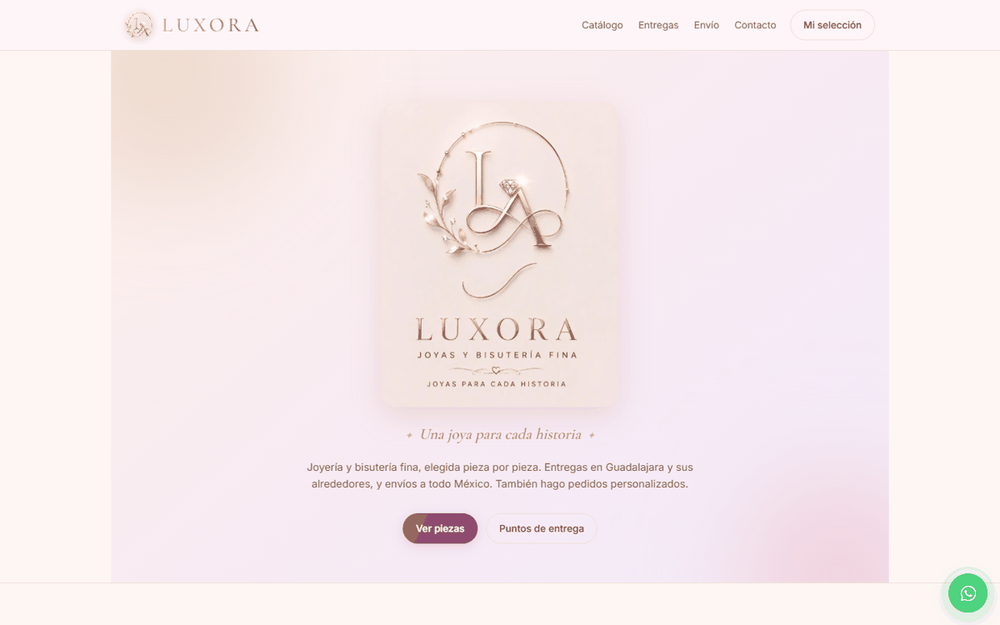
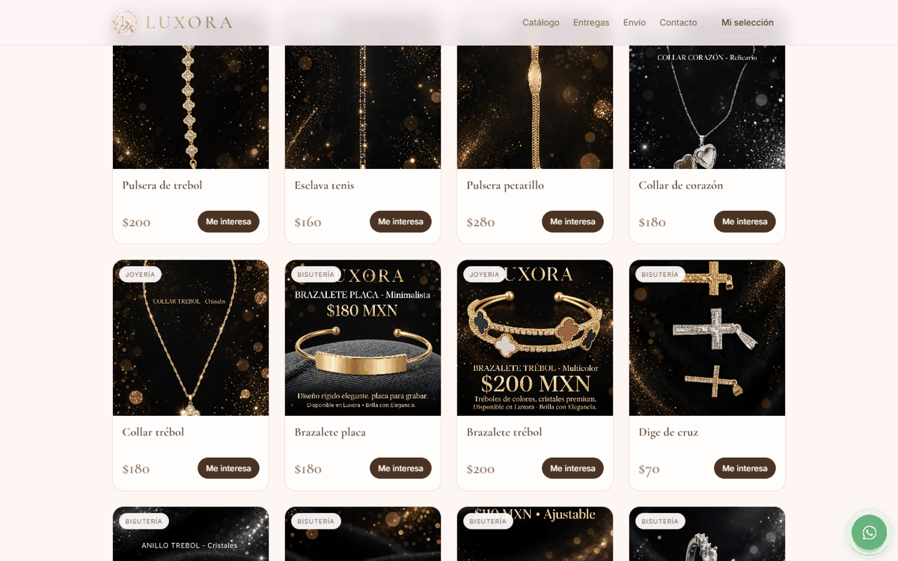
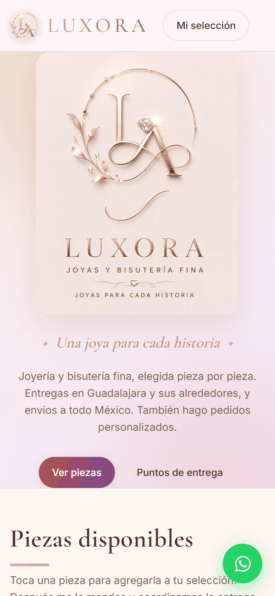

# Luxora — joyería y bisutería fina

**Demo en vivo:** https://luxora-gdl.netlify.app

Tienda en línea para una joyería de Guadalajara: catálogo filtrable de anillos, aretes, collares y pulseras, una "selección" que funciona como carrito y se manda por WhatsApp, puntos de entrega en la ciudad y envíos a todo México.

> 🔒 El código fuente es privado. Este repositorio es una vitrina del proyecto: qué hace, cómo está hecho y pruebas de que funciona.

## Qué hace
- Catálogo con filtros por tipo (anillos, aretes, collares, pulseras) y material (joyería o bisutería).
- "Mi selección": el cliente junta piezas y las manda por WhatsApp para coordinar la entrega.
- Puntos y horarios de entrega en Guadalajara.
- Datos de catálogo y entregas en Supabase.

## Stack
HTML, CSS y JavaScript sin framework (ligero y rápido) · Netlify · Supabase.

## Capturas
| Escritorio | Móvil |
|---|---|
|   |  |
